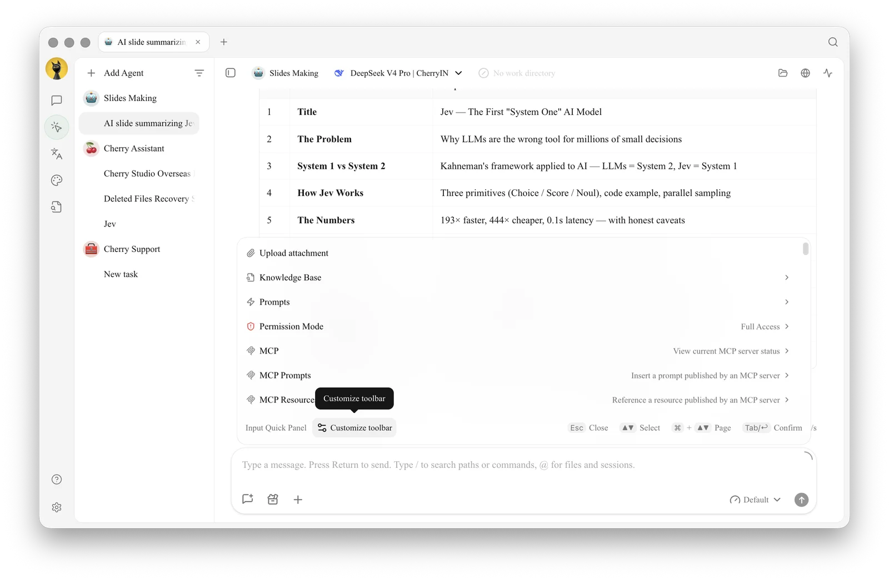
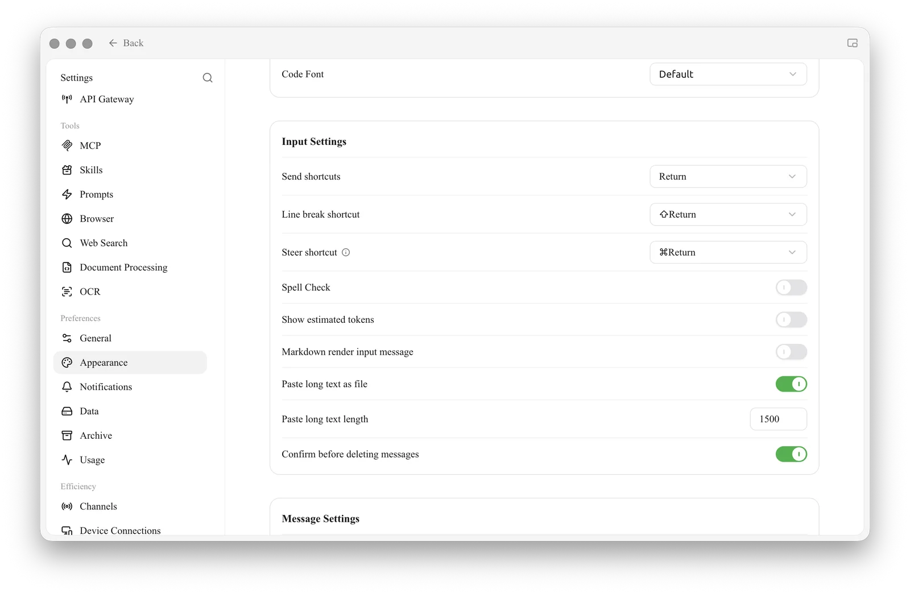

# Input Toolbar and Efficiency Tools

Why do pinned tools not appear in another input area?

The Chat, Agent, Quick Assistant, and Drawing pages support different tools. The pinned layouts for Chat and Agent are saved separately. Open [Customize toolbar] again in the target input area.

<figure><figcaption></figcaption></figure>

<figure><figcaption></figcaption></figure>
