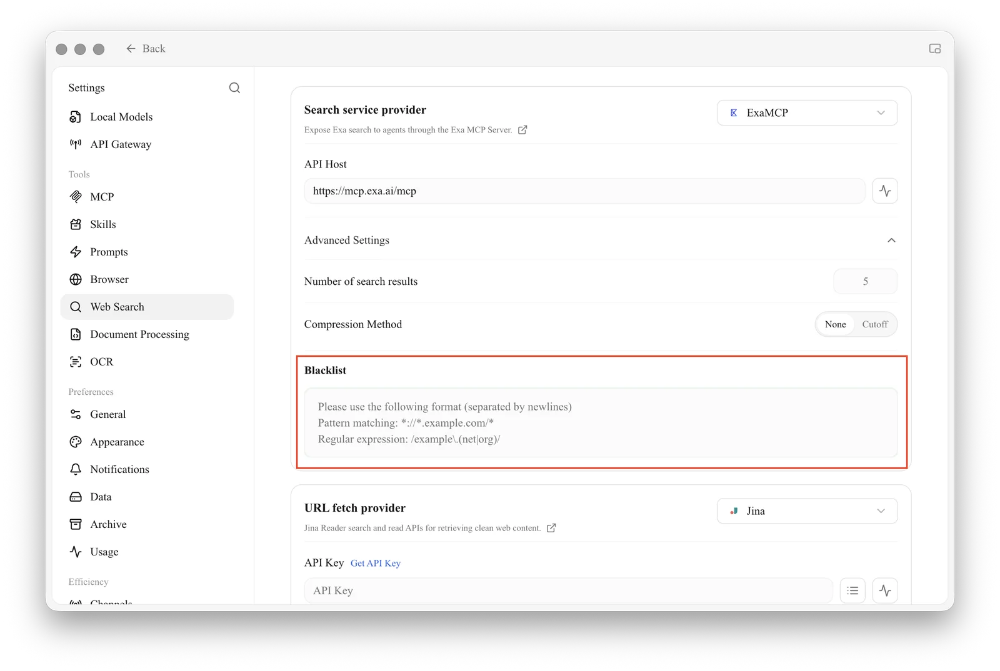

# Web Search Blacklist Configuration

Cherry Studio supports configuring blacklists in two ways: manually and by adding subscriptions. Configuration rules refer to [ublacklist](https://github.com/iorate/ublacklist).

## Manual Configuration

Open **Settings → Web Search**, expand **Advanced Settings** under the search service provider, and enter rules in the **Blacklist** box, one per line. Rules can be specified using: [Match Patterns](https://developer.mozilla.org/en-US/docs/Mozilla/Add-ons/WebExtensions/Match_patterns) (e.g., `*://*.example.com/*`) or [Regular Expressions](https://developer.mozilla.org/en-US/docs/Web/JavaScript/Guide/Regular_expressions) (e.g., `/example\.(net|org)/`).

<figure><figcaption>
Enter blacklist rules in Settings → Web Search → Advanced Settings
</figcaption></figure>

## Subscription Configuration

You can also subscribe to public rule sets. This website lists some subscriptions:
https://iorate.github.io/ublacklist/subscriptions

Here are some recommended subscription links:

| Name                                                                                                    | Link                                                                                                   | Type          |
| :---------------------------------------------------------------------------------------------------- | :--------------------------------------------------------------------------------------------------- | :------------ |
| [uBlacklist subscription compilation](https://github.com/eallion/uBlacklist-subscription-compilation) | https://git.io/ublacklist                                                                            | Chinese       |
| [uBlockOrigin-HUGE-AI-Blocklist](https://github.com/laylavish/uBlockOrigin-HUGE-AI-Blocklist)         | https://raw.githubusercontent.com/laylavish/uBlockOrigin-HUGE-AI-Blocklist/main/list_uBlacklist.txt | AI Generated |
